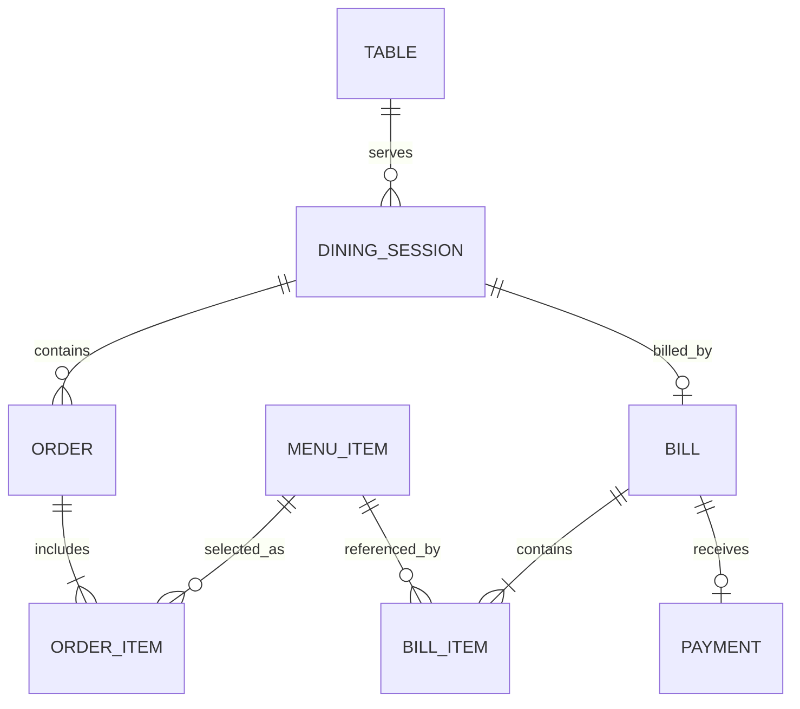

# SRS – Hệ thống quản lý nhà hàng

| Thông tin | Nội dung |
|---|---|
| Phiên bản | 1.9 – Chốt kiến trúc Services + Repositories trước khi triển khai MVP |
| Ngày cập nhật | 21/11/2026 |
| Trạng thái | Các quyết định nghiệp vụ đã chốt; sẵn sàng thiết kế và triển khai MVP. Framework GUI và định dạng file cụ thể sẽ được chọn ở bước thiết kế kỹ thuật. |
| Nền tảng dự kiến | C++ – lập trình hướng đối tượng (OOP) |
| Thay đổi ở phiên bản này | Chốt kiến trúc mã nguồn theo hướng GUI + Models + Services + Repositories + Structure; loại bỏ lớp Managers riêng và không tạo tầng DAL/DataStorage riêng trong MVP. Repository trực tiếp đảm nhiệm truy xuất và lưu dữ liệu bằng file. Giữ nguyên các quyết định nghiệp vụ đã chốt ở phiên bản 1.8: GUI, lưu file, mỗi DiningSession tối đa một Bill, mỗi Bill được thanh toán đúng một lần bằng một Payment có số tiền bằng tổng hóa đơn, không thuế/phí/giảm giá/hoàn tiền, bắt buộc lưu `guestCount`, và quy tắc FR-OR-08. |

---

## 1. Tài liệu này dùng để làm gì?

Tài liệu SRS (Software Requirements Specification) mô tả chương trình cần làm gì và phải tuân theo những quy tắc nghiệp vụ nào.

Tài liệu là cơ sở để:

- Thống nhất cách nhà hàng vận hành trước khi lập trình.
- Xác định các class, thuộc tính và quan hệ giữa chúng.
- Chia chương trình thành các module `.h` và `.cpp`.
- Kiểm tra xem chương trình sau khi hoàn thành có đáp ứng yêu cầu hay không.

**Phạm vi của tài liệu:** nhà hàng phục vụ khách tại bàn. Đây là phiên bản đầu tiên (MVP), vì vậy những tính năng chưa cần thiết sẽ được để dành cho phiên bản sau.

## 2. Tổng quan chương trình

### 2.1. Mục tiêu

Xây dựng chương trình để một Quản lý nhà hàng trực tiếp quản lý toàn bộ quá trình phục vụ một nhóm khách:

1. Tìm và xếp bàn.
2. Tạo phiên ăn cho nhóm khách.
3. Nhận một hoặc nhiều lần gọi món.
4. Theo dõi trạng thái phục vụ của từng món.
5. Lập hóa đơn.
6. Ghi nhận một lần thanh toán đủ và kết thúc phiên ăn.

Các dữ liệu liên quan phải nhất quán. Ví dụ: không thể xếp hai nhóm khách vào cùng một bàn, không thể gọi món cho phiên ăn đã đóng và không được giải phóng bàn khi hóa đơn chưa thanh toán đủ.

### 2.2. Những gì phiên bản đầu tiên sẽ có

| Phân hệ | Chức năng chính |
|---|---|
| Quản lý bàn | Thêm, sửa, ngừng sử dụng, tìm bàn và lọc danh sách bàn đang trống theo trạng thái. |
| Quản lý thực đơn | Thêm, sửa thông tin và tìm món theo ID. |
| Quản lý phiên ăn | Tạo phiên ăn, xếp bàn, xem trạng thái, hủy hoặc đóng phiên. |
| Quản lý Order | Tạo nhiều lần gọi món cho một phiên ăn; theo dõi trạng thái từng món. |
| Quản lý hóa đơn | Tạo hóa đơn từ các món hợp lệ và tính tổng tiền. |
| Quản lý thanh toán | Ghi nhận khoản thanh toán và xác định hóa đơn đã trả đủ hay chưa. |
| Giao diện | Giao diện đồ họa (GUI) dành cho Quản lý nhà hàng. |
| Lưu dữ liệu | Dữ liệu quan trọng được đọc/ghi bằng file và được giữ lại sau khi đóng chương trình. |

### 2.3. Những gì chưa làm trong phiên bản đầu

- Đặt bàn trước theo ngày và giờ.
- Đặt món trực tuyến, giao hàng hoặc bán mang đi.
- Quản lý nguyên liệu, nhà cung cấp và kho hàng.
- Quản lý ca làm, chấm công và tiền lương.
- Quản lý nhiều chi nhánh hoặc đồng bộ qua mạng.
- Tự động kết nối ngân hàng/cổng thanh toán.
- Tích điểm thành viên và chương trình khuyến mãi phức tạp.

Có thể bổ sung các chức năng này ở phiên bản sau.

### 2.4. Các giả định đang dùng

- Nhà hàng phục vụ khách tại bàn.
- Một bàn chỉ có tối đa một phiên ăn đang hoạt động.
- Một phiên ăn có thể có nhiều lần gọi món (`Order`).
- Trong MVP, mỗi phiên ăn có tối đa một hóa đơn (`Bill`).
- Mỗi Bill chỉ được thanh toán đúng một lần bằng một `Payment`; số tiền thanh toán phải bằng chính xác tổng hóa đơn.
- Đơn vị tiền tệ là VND.
- Chỉ có một người dùng duy nhất: Quản lý nhà hàng. MVP không cần đăng nhập, phân quyền hoặc quản lý nhiều tài khoản.
- Chương trình được sử dụng bởi một người tại một thời điểm; không xử lý nhiều người dùng thao tác đồng thời trên nhiều máy.
- Số lượng khách gọi thuộc `OrderItem`, không phải số lượng tồn kho của món ăn.
- `guestCount` là thông tin bắt buộc của `DiningSession`, phải lớn hơn 0; chỉ dùng để ghi nhận số lượng khách, không dùng để đánh giá sức chứa hay chọn bàn.

## 3. Ai sẽ sử dụng chương trình?

MVP chỉ có **một người dùng duy nhất: Quản lý nhà hàng**. Người này trực tiếp thực hiện tất cả thao tác trên chương trình, bao gồm quản lý bàn, thực đơn, phiên ăn, gọi món, cập nhật trạng thái món, lập hóa đơn và ghi nhận thanh toán.

| Tác nhân | Công việc |
|---|---|
| Quản lý nhà hàng (người dùng duy nhất) | Thực hiện toàn bộ thao tác quản lý và vận hành được hỗ trợ trong MVP. |
| Hệ thống | Kiểm tra dữ liệu, áp dụng quy tắc nghiệp vụ, tính tiền và cập nhật trạng thái liên quan. |

Không có tài khoản nhân viên phục vụ, thu ngân hoặc người dùng khác trong MVP. Chương trình không cần chức năng đăng nhập, phân quyền hay phân biệt người thực hiện thao tác. Mọi thao tác được hiểu là do Quản lý nhà hàng thực hiện.

**Lưu ý về cách gọi:** “Quản lý nhà hàng” là người sử dụng chương trình. Các class có hậu tố `Service` là thành phần mã nguồn xử lý nghiệp vụ; đây không phải tài khoản hoặc người sử dụng khác.

## 4. Quy trình hoạt động chính

### 4.1. Tiếp nhận khách và xếp bàn

1. Quản lý mở chức năng tạo phiên ăn và nhập `guestCount` (số lượng khách). Giá trị này bắt buộc phải là số nguyên lớn hơn 0 và chỉ dùng để ghi nhận, không ảnh hưởng đến việc chọn bàn.
2. `TableService` hiển thị danh sách các bàn đang hoạt động và có trạng thái `Available`. Việc lọc bàn trống chỉ dựa trên trạng thái bàn, không dựa trên sức chứa.
3. Quản lý trực tiếp chọn một bàn trong danh sách bàn trống.
4. Quản lý chuyển sang chức năng tạo phiên ăn và xác nhận bàn đã chọn. `DiningSessionService` kiểm tra lại bàn đó vẫn đang `Available` trước khi tạo phiên.
5. Nếu hợp lệ, hệ thống tạo `DiningSession`, lưu `tableId` và chuyển bàn sang `Occupied` như một thao tác nghiệp vụ thống nhất.
6. Nếu bàn không còn trống hoặc đã ngừng hoạt động, hệ thống từ chối tạo phiên và yêu cầu Quản lý chọn lại từ danh sách bàn trống mới nhất.

### 4.2. Gọi món và phục vụ

1. Quản lý chọn một phiên ăn đang hoạt động.
2. Quản lý tạo một `Order` mới.
3. Quản lý thêm một hoặc nhiều món vào Order.
4. Mỗi món được lưu thành một `OrderItem`, bao gồm số lượng và giá tại thời điểm gọi.
5. Khi xác nhận món đã được giao cho khách, Quản lý cập nhật OrderItem tương ứng sang trạng thái `Served`.
6. Khách có thể gọi thêm món bằng cách tạo Order mới trong cùng phiên ăn.

### 4.3. Lập hóa đơn và thanh toán

1. Quản lý yêu cầu thanh toán cho phiên ăn.
2. Hệ thống kiểm tra các món trong phiên. Món đã hủy không được tính tiền; các món chưa hoàn tất phải được phục vụ hoặc hủy hợp lệ trước khi chốt hóa đơn. Chỉ lập Bill khi có ít nhất một OrderItem đã `Served`; nếu chưa có món nào được phục vụ thì xử lý hủy phiên ăn theo mục 4.4, không tạo hóa đơn 0 đồng.
3. Hệ thống tạo `Bill` và các `BillItem` từ những món đủ điều kiện tính tiền.
4. Hệ thống tính tổng hóa đơn; trong MVP không áp dụng thuế, phí dịch vụ hoặc giảm giá nên tổng hóa đơn bằng tổng thành tiền các BillItem.
5. Quản lý ghi nhận đúng một `Payment` với số tiền bằng chính xác tổng hóa đơn. Thanh toán thiếu hoặc thừa đều bị từ chối.
6. Khi Payment hợp lệ được ghi nhận, Bill chuyển sang `Paid`, DiningSession chuyển sang `Closed` và Table chuyển về `Available`. Trước thời điểm đó, Bill vẫn `Unpaid`, phiên ăn chưa đóng và bàn chưa được giải phóng.

### 4.4. Hủy phiên ăn

- Chỉ được hủy phiên ăn chưa kết thúc.
- Nếu chưa có món nào được giao cho khách, Quản lý có thể hủy phiên ăn, chuyển các OrderItem chưa phục vụ sang `Cancelled` và giải phóng bàn.
- Nếu đã có món được giao cho khách, Quản lý không được xóa hoặc hủy toàn bộ lịch sử giao dịch. Các món đã phục vụ vẫn phải được tính vào hóa đơn; những món chưa phục vụ phải được hủy hợp lệ.
- MVP không hỗ trợ quy trình hoàn tiền. Không có chức năng tạo giao dịch hoàn tiền hoặc điều chỉnh Payment sau khi đã ghi nhận.

## 5. Yêu cầu chức năng

Các yêu cầu được chia theo phân hệ. `Must` là bắt buộc trong MVP; `Should` là nên có; `Could` là có thể bổ sung.

### 5.1. Quản lý bàn – `Table`

| ID | Chương trình cần làm gì? | Ưu tiên |
|---|---|---|
| FR-TB-01 | Thêm bàn với ID/mã duy nhất và thông tin nhận diện hợp lệ. | Must |
| FR-TB-02 | Xem danh sách bàn và thông tin một bàn. | Must |
| FR-TB-03 | Sửa thông tin nhận diện của bàn, ví dụ mã hiển thị hoặc tên bàn. | Must |
| FR-TB-04 | Tìm bàn theo ID/mã bàn. | Must |
| FR-TB-05 | Tìm tất cả bàn đang trống. | Must |
| FR-TB-07 | Ngừng sử dụng bàn; không cho xóa bàn đang có khách hoặc làm mất lịch sử cũ. | Must |
| FR-TB-08 | Cập nhật trạng thái bàn khi tạo, hủy hoặc đóng phiên ăn hợp lệ. | Must |

**Dữ liệu của `Table`:**

- `id`: ID duy nhất của bàn.
- `code` hoặc `name`: mã hiển thị, ví dụ `B01`.
- `status`: trạng thái bàn.
- `isActive`: bàn còn được sử dụng hay đã ngừng sử dụng.

**Trạng thái bàn:**

| Trạng thái | Ý nghĩa |
|---|---|
| `Available` | Bàn đang trống. |
| `Occupied` | Bàn đang có khách. |
| `Maintenance` | Bàn đang bảo trì, không được xếp khách. |
| `Reserved` | Đã đặt trước; để dành cho phiên bản sau nếu chưa làm đặt bàn. |

MVP chỉ cần triển khai `Available`, `Occupied` và `Maintenance`.

### 5.2. Quản lý thực đơn – `MenuItem`

| ID | Chương trình cần làm gì? | Ưu tiên |
|---|---|---|
| FR-MN-01 | Thêm món với ID duy nhất, tên không rỗng và giá hợp lệ. | Must |
| FR-MN-02 | Xem danh sách món và thông tin chi tiết. | Must |
| FR-MN-03 | Sửa tên, giá và mô tả món. | Must |
| FR-MN-04 | Tìm món theo ID. | Must |

**Dữ liệu của `MenuItem`:**

- `id`: ID duy nhất của món.
- `name`: tên món.
- `price`: giá hiện tại, lưu bằng số nguyên VND (`long long`).
- `description`: mô tả, không bắt buộc.

Trong MVP, `MenuItem` không có trạng thái kinh doanh `Available/Unavailable`. Chức năng tìm món theo tên và ngừng bán món không nằm trong phạm vi hiện tại. Quản lý chọn món theo ID từ danh sách thực đơn. Khi đã chọn một món để thêm vào Order nhưng muốn bỏ món đó, Quản lý thực hiện ở module `Order` bằng cách loại bỏ món khi Order còn là `Draft` hoặc hủy `OrderItem` khi đã xác nhận nhưng món chưa được giao cho khách.

**Lưu ý về số lượng:** `MenuItem` không cần trường số lượng trong MVP. Số lượng khách gọi được lưu ở `OrderItem`. Chỉ thêm `stockQuantity` khi chương trình có nghiệp vụ quản lý tồn kho rõ ràng.

### 5.3. Quản lý phiên ăn – `DiningSession`

| ID | Chương trình cần làm gì? | Ưu tiên |
|---|---|---|
| FR-DS-01 | Tạo phiên ăn cho bàn đã được Quản lý chọn từ danh sách bàn trống do `TableService` cung cấp và lưu `guestCount` hợp lệ. | Must |
| FR-DS-02 | Nhận `tableId` của bàn do Quản lý chọn; `DiningSession` không tự tìm hoặc lọc bàn trống. | Must |
| FR-DS-03 | Kiểm tra lại bàn được chọn vẫn `Available` và đang hoạt động trước khi tạo phiên ăn. | Must |
| FR-DS-04 | Lưu bàn được xếp thông qua `tableId`. | Must |
| FR-DS-06 | Xem phiên ăn đang hoạt động và lịch sử phiên ăn. | Must |
| FR-DS-07 | Hủy phiên ăn theo quy trình tại mục 4.4. | Must |
| FR-DS-08 | Đóng phiên ăn khi hóa đơn đã thanh toán đủ. | Must |
| FR-DS-09 | Tra cứu thanh toán thông qua Bill/Payment liên quan. | Must |

**Lưu ý về FR-DS-05 đã loại bỏ:** Không cần một yêu cầu chức năng riêng để tìm và chặn bàn đã có khách. `TableService` chỉ đưa bàn `Available` vào danh sách lựa chọn; sau khi tạo phiên ăn thành công, bàn chuyển sang `Occupied`. `DiningSessionService` vẫn kiểm tra lại trạng thái bàn ngay trước khi tạo phiên để tránh trường hợp bàn vừa được chọn nhưng trạng thái đã thay đổi. Đây là kiểm tra toàn vẹn dữ liệu trong quy trình tạo phiên, không phải một chức năng độc lập.

**Dữ liệu của `DiningSession`:**

- `id`: ID duy nhất của phiên ăn.
- `tableId`: ID bàn được xếp.
- `guestCount`: số lượng khách bắt buộc phải lưu, là số nguyên lớn hơn 0; chỉ dùng để ghi nhận thông tin, không dùng để tìm hoặc chọn bàn.
- `openedAt`: thời điểm bắt đầu.
- `closedAt`: thời điểm kết thúc, có thể chưa có.
- `status`: trạng thái phiên ăn.
- `note`: ghi chú, không bắt buộc.

**Trạng thái phiên ăn:**

| Trạng thái | Ý nghĩa |
|---|---|
| `Active` | Khách đang sử dụng bàn. |
| `WaitingForPayment` | Đang chờ hoàn tất thanh toán. |
| `Closed` | Phiên ăn đã kết thúc hợp lệ. |
| `Cancelled` | Phiên ăn đã bị hủy. |

Không dùng `Paid/Unpaid` làm trạng thái của DiningSession. Trạng thái thanh toán thuộc về Bill; DiningSession tra cứu Bill khi cần biết tình trạng thanh toán.

### 5.4. Quản lý gọi món – `Order` và `OrderItem`

| ID | Chương trình cần làm gì? | Ưu tiên |
|---|---|---|
| FR-OR-01 | Tạo Order cho một DiningSession đang hoạt động. | Must |
| FR-OR-02 | Cho phép một DiningSession có nhiều Order. | Must |
| FR-OR-03 | Thêm nhiều món vào một Order. | Must |
| FR-OR-04 | Lưu số lượng và ghi chú riêng cho từng món. | Must |
| FR-OR-05 | Chỉ cho phép thêm món đang tồn tại trong danh sách thực đơn vào Order. | Must |
| FR-OR-06 | Lưu tên và giá món tại thời điểm gọi. | Must |
| FR-OR-07 | Theo dõi trạng thái riêng của từng OrderItem. | Must |
| FR-OR-08 | Cho phép Quản lý loại bỏ món khỏi Order khi Order còn ở `Draft`; sau khi Order được xác nhận, chỉ cho phép hủy `OrderItem` chưa `Served`. Việc hủy phải được ghi nhận bằng trạng thái `Cancelled`, không xóa vật lý lịch sử. | Must |
| FR-OR-09 | Quản lý xem Order và các món chưa được giao cho khách theo phiên ăn. | Must |
| FR-OR-10 | Sửa số lượng/nội dung món khi trạng thái cho phép. | Should |

**Phân biệt hai class:**

- `Order`: đại diện cho một lần gọi món, gắn với một phiên ăn.
- `OrderItem`: đại diện cho một món cụ thể trong lần gọi đó.

**Dữ liệu của `Order`:** `id`, `diningSessionId`, `createdAt`, `status`.

**Dữ liệu của `OrderItem`:** `id`, `menuItemId`, `itemNameSnapshot`, `unitPriceAtOrder`, `quantity`, `note`, `status`.

**Trạng thái của `OrderItem`:**

| Trạng thái | Ý nghĩa |
|---|---|
| `Pending` | Món đã được ghi nhận trong Order nhưng chưa giao cho khách. |
| `Served` | Món đã được giao cho khách. |
| `Cancelled` | Món đã được hủy hợp lệ trước khi tính tiền. |

Trạng thái tổng của Order có thể được xác định dựa trên các OrderItem. Ví dụ: Order chỉ được xem là hoàn tất khi tất cả món không bị hủy đã ở trạng thái `Served`.

### 5.5. Quản lý hóa đơn – `Bill` và `BillItem`

| ID | Chương trình cần làm gì? | Ưu tiên |
|---|---|---|
| FR-BL-01 | Chỉ tạo Bill cho DiningSession có ít nhất một OrderItem đã `Served`. | Must |
| FR-BL-02 | Không tạo quá một Bill cho cùng một DiningSession trong MVP. | Must |
| FR-BL-03 | Tạo BillItem từ các món đủ điều kiện tính tiền; không tính món đã hủy. | Must |
| FR-BL-04 | Lưu tên món, số lượng và đơn giá tại thời điểm lập hóa đơn. | Must |
| FR-BL-05 | Tính thành tiền từng dòng, tạm tính và tổng hóa đơn. | Must |
| FR-BL-06 | Hiển thị tổng tiền hóa đơn và tình trạng thanh toán (`Unpaid` hoặc `Paid`). | Must |

**Dữ liệu của `Bill`:**

- `id`: ID hóa đơn.
- `diningSessionId`: phiên ăn tương ứng.
- `createdAt`: thời điểm lập hóa đơn.
- `items`: danh sách BillItem.
- `subtotal`: tổng tiền của tất cả BillItem.
- `totalAmount`: tổng tiền cần thanh toán; trong MVP bằng `subtotal`.
- `paymentStatus`: trạng thái thanh toán (`Unpaid` hoặc `Paid`).

**Dữ liệu của `BillItem`:** `id`, `menuItemId`, `itemNameSnapshot`, `unitPriceSnapshot`, `quantity`, `lineTotal`.

Trong đó:

```text
lineTotal = unitPriceSnapshot * quantity
subtotal = tổng lineTotal của các BillItem
totalAmount = subtotal
```

MVP không áp dụng thuế, phí dịch vụ hoặc giảm giá nên không cần các thuộc tính tương ứng trong `Bill`. Không cho phép tổng hóa đơn âm.

### 5.6. Quản lý thanh toán – `Payment`

| ID | Chương trình cần làm gì? | Ưu tiên |
|---|---|---|
| FR-PY-01 | Ghi nhận một Payment cho Bill chưa được thanh toán. | Must |
| FR-PY-02 | Lưu số tiền, phương thức và thời điểm thanh toán. | Must |
| FR-PY-03 | Chuyển Bill sang `Paid` khi Payment hợp lệ được ghi nhận. | Must |
| FR-PY-04 | Mỗi Bill chỉ được có tối đa một Payment; không hỗ trợ thanh toán nhiều lần hoặc thanh toán một phần. | Must |
| FR-PY-05 | Từ chối khoản thanh toán có số tiền nhỏ hơn hoặc bằng 0. | Must |
| FR-PY-06 | Chỉ chấp nhận Payment có số tiền bằng chính xác `totalAmount` của Bill; từ chối thanh toán thiếu hoặc thừa. | Must |

**Dữ liệu của `Payment`:** `id`, `billId`, `amount`, `method`, `paidAt`, `referenceCode`, `note`. Mỗi Bill có tối đa một Payment; `amount` phải bằng chính xác `Bill.totalAmount`.

**Trạng thái thanh toán của Bill:**

| Trạng thái | Ý nghĩa |
|---|---|
| `Unpaid` | Chưa ghi nhận Payment hợp lệ. |
| `Paid` | Đã ghi nhận một Payment có số tiền bằng tổng hóa đơn. |

Trạng thái này được xác định dựa trên việc Bill đã có Payment hợp lệ hay chưa, không để người dùng tự chọn tùy ý.

## 6. Trạng thái chính và luồng thay đổi trạng thái

Bảng dưới đây tổng hợp các trạng thái được sử dụng trong MVP. Mũi tên biểu thị hướng chuyển trạng thái hợp lệ. Quản lý nhà hàng là người trực tiếp thực hiện thao tác; hệ thống kiểm tra điều kiện và tự cập nhật những trạng thái liên quan.

### 6.1. Bảng trạng thái chính

| Đối tượng | Luồng trạng thái |
|---|---|
| `Table` | `Available` ↔ `Occupied`; `Available` ↔ `Maintenance` |
| `DiningSession` | `Active` → `WaitingForPayment` → `Closed`; hoặc `Active` → `Cancelled` |
| `Order` | `Draft` → `Pending` → `InProgress` → `Completed`; hoặc `Pending` → `Completed`; hoặc `Draft/Pending` → `Cancelled` |
| `OrderItem` | `Pending` → `Served`; hoặc `Pending` → `Cancelled` |
| `Bill` | `Unpaid` → `Paid` |
| `BillItem` | Không có trạng thái riêng; là dòng chi tiết được tạo khi lập Bill. |
| `Payment` | Không có trạng thái vòng đời riêng trong MVP; chỉ ghi nhận bản thanh toán hợp lệ. |

`Reserved` của `Table` chưa được đưa vào luồng vì chức năng đặt bàn trước không thuộc MVP. `MenuItem` không có luồng trạng thái kinh doanh riêng trong MVP. `OrderItem` trong Order `Draft` có thể được Quản lý loại bỏ; sau khi Order được xác nhận, không được xóa vật lý OrderItem mà chỉ được chuyển món chưa phục vụ sang `Cancelled` theo quy tắc nghiệp vụ. `KitchenTask` không thuộc mô hình của phiên bản này vì chương trình không có module/bộ phận bếp hoặc quầy.

### 6.2. Mô tả luồng thay đổi trạng thái

#### 1. Table – Trạng thái bàn

- `Available` → `Occupied`: xảy ra khi hệ thống tạo `DiningSession` thành công và gắn phiên ăn với bàn đó.
- `Occupied` → `Available`: xảy ra khi phiên ăn được `Closed`, hoặc được `Cancelled` theo đúng điều kiện hủy.
- `Available` → `Maintenance`: Quản lý chuyển bàn sang bảo trì; bàn không còn được đưa vào danh sách xếp khách.
- `Maintenance` → `Available`: Quản lý xác nhận bàn đã bảo trì xong và có thể phục vụ trở lại.

Không cho chuyển trực tiếp `Occupied` sang `Maintenance`. Bàn phải kết thúc phiên ăn và trở về `Available` trước khi được đánh dấu bảo trì. Không được xếp khách vào bàn `Maintenance`.

#### 2. MenuItem – Thông tin món ăn

Trong MVP, `MenuItem` không có vòng đời trạng thái kinh doanh. Quản lý có thể xem danh sách món, tìm theo ID và sửa thông tin món. Khi đã chọn một món để thêm vào Order nhưng muốn bỏ món đó, Quản lý thực hiện ở module `Order` bằng cách loại bỏ món khi Order còn là `Draft` hoặc hủy `OrderItem` khi đã xác nhận nhưng món chưa được giao cho khách.

#### 3. DiningSession – Trạng thái phiên ăn

- `Active` → `WaitingForPayment`: Quản lý bắt đầu quy trình thanh toán sau khi các món trong phiên đã được giao cho khách hoặc được hủy hợp lệ và hệ thống lập Bill.
- `WaitingForPayment` → `Closed`: chỉ xảy ra khi Bill liên quan đã được thanh toán đủ (`Paid`). Sau đó hệ thống giải phóng bàn và chuyển Table về `Available`.
- `Active` → `Cancelled`: chỉ áp dụng khi chưa có OrderItem nào được giao cho khách. Hệ thống hủy các món chưa phục vụ và giải phóng bàn.

Nếu đã có món được giao cho khách, không được hủy toàn bộ phiên ăn để xóa nghĩa vụ thanh toán. Các món đã `Served` vẫn phải được tính tiền; các món chưa phục vụ được xử lý hủy hợp lệ trước khi lập hóa đơn. Phiên ăn không được chuyển `Closed` khi Bill chưa `Paid`.

#### 4. Order – Trạng thái tổng của lần gọi món

- `Draft` → `Pending`: Order đã được tạo, có ít nhất một OrderItem và được Quản lý xác nhận.
- `Pending` → `InProgress`: đã có ít nhất một OrderItem được chuyển sang `Served`, trong khi vẫn còn OrderItem ở trạng thái `Pending`.
- `Pending` → `Completed`: có thể xảy ra khi Order chỉ có một OrderItem, món đó được chuyển thẳng sang `Served` nên không có giai đoạn `InProgress`.
- `InProgress` → `Completed`: tất cả OrderItem đã có kết quả cuối cùng là `Served` hoặc `Cancelled`, và có ít nhất một món đã `Served`.
- `Draft` hoặc `Pending` → `Cancelled`: Order bị hủy khi chưa có món nào `Served`; các OrderItem thuộc Order phải được hủy hợp lệ.

Trạng thái `Order` nên được xác định từ trạng thái các `OrderItem`, không để Quản lý tự chọn tùy ý. Nếu tất cả OrderItem đều `Cancelled`, Order được xem là `Cancelled`. Nếu Order có ít nhất một món `Served` và không còn món `Pending`, Order được xem là `Completed`.

Do MVP chỉ có một Quản lý thao tác, không cần các trạng thái `Approved` hoặc `Rejected` để chờ một người dùng/bộ phận khác duyệt Order.

#### 5. OrderItem – Trạng thái từng món được gọi

- `Pending` → `Served`: Quản lý xác nhận món đã được giao cho khách.
- `Pending` → `Cancelled`: chỉ khi Order cha đã được xác nhận (`Pending` hoặc `InProgress`); Quản lý hủy món trước khi món được giao cho khách và trước khi tính tiền. Khi Order cha còn ở `Draft`, Quản lý có thể loại bỏ món khỏi Order.

Không cho chuyển `Served` về `Pending` hoặc `Cancelled` trong MVP. Món đã giao cho khách không được xóa khỏi lịch sử gọi món.

#### 6. Bill – Trạng thái thanh toán hóa đơn

- `Unpaid` → `Paid`: Quản lý thanh toán đúng một lần với số tiền bằng chính xác tổng hóa đơn và hệ thống ghi nhận Payment hợp lệ.

MVP không có trạng thái `PartiallyPaid` vì không hỗ trợ thanh toán một phần. Nếu số tiền nhập vào nhỏ hơn hoặc lớn hơn tổng hóa đơn, hoặc Bill đã có Payment, hệ thống từ chối và giữ nguyên dữ liệu. Chương trình chỉ ghi nhận thanh toán thủ công, không kết nối cổng thanh toán tự động.

#### 7. BillItem và Payment – Dữ liệu không có luồng trạng thái riêng

- `BillItem` là dòng chi tiết của Bill, lưu món, số lượng và đơn giá tại thời điểm lập hóa đơn. Trong MVP, BillItem không cần enum trạng thái.
- `Payment` là bản ghi duy nhất cho một Bill. Khi khoản thanh toán không hợp lệ (bằng 0, âm, nhỏ hơn hoặc lớn hơn tổng hóa đơn, hoặc Bill đã có Payment), hệ thống từ chối và không tạo Payment tương ứng.

### 6.3. Luồng trạng thái tổng thể của một lượt khách

1. `TableService` hiển thị các bàn `Available`; Quản lý chọn một bàn rồi tạo phiên ăn: `Table: Available → Occupied`; `DiningSession: Active`.
2. Quản lý tạo và xác nhận Order: `Order: Draft → Pending`; các `OrderItem` bắt đầu ở `Pending`.
3. Khi xác nhận đã giao từng món: `OrderItem: Pending → Served`; trạng thái tổng của Order được cập nhật theo các OrderItem.
4. Khi khách yêu cầu thanh toán: `DiningSession: Active → WaitingForPayment`; hệ thống tạo Bill ở trạng thái `Unpaid`.
5. Quản lý nhập số tiền thanh toán đúng bằng tổng hóa đơn; hệ thống ghi nhận một Payment và chuyển Bill `Unpaid → Paid`.
6. Khi Bill `Paid`: `DiningSession: WaitingForPayment → Closed`; `Table: Occupied → Available`.

Nếu phiên ăn bị hủy trước khi có món nào được giao cho khách, `DiningSession` chuyển `Cancelled` và bàn được giải phóng về `Available` theo quy tắc tại mục 4.4.

---

## 7. Mô hình dữ liệu và quan hệ giữa các class

### 7.1. Các class chính

| Class | Đại diện cho | Quan hệ chính |
|---|---|---|
| `Table` | Một bàn trong nhà hàng. | Một bàn có thể được dùng trong nhiều DiningSession ở các thời điểm khác nhau. |
| `MenuItem` | Một món trong thực đơn. | Một món có thể xuất hiện trong nhiều OrderItem và BillItem. |
| `DiningSession` | Một lượt khách sử dụng bàn. | Thuộc một Table; có nhiều Order; có tối đa một Bill trong MVP. |
| `Order` | Một lần gọi món. | Thuộc một DiningSession; chứa nhiều OrderItem. |
| `OrderItem` | Một dòng món được gọi. | Thuộc một Order; tham chiếu MenuItem. |
| `Bill` | Hóa đơn của phiên ăn. | Thuộc một `DiningSession`; chứa nhiều `BillItem` và có tối đa một `Payment`. |
| `BillItem` | Một dòng món trên hóa đơn. | Thuộc một Bill; tham chiếu MenuItem. |
| `Payment` | Lần thanh toán duy nhất cho một hóa đơn. | Thuộc đúng một `Bill`; mỗi Bill có tối đa một Payment. |

### 7.2. Sơ đồ quan hệ



**Cách đọc sơ đồ:** một phiên ăn có thể có nhiều Order nhưng tối đa một Bill; một Order có nhiều OrderItem; một Bill có nhiều BillItem và tối đa một Payment.

### 7.3. Những điểm cần hiểu đúng về dữ liệu

**1. Vì sao cần `OrderItem`?**

Một lần gọi món có thể gồm nhiều món khác nhau. Mỗi món có số lượng, ghi chú và trạng thái phục vụ riêng, vì vậy không thể chỉ lưu một `menuItemId` trong Order.

**2. Vì sao cần `BillItem`?**

Hóa đơn cần lưu lại chính xác món, số lượng và đơn giá tại thời điểm lập hóa đơn. Không nên chỉ lấy giá hiện tại từ thực đơn vì giá có thể thay đổi.

**3. Vì sao cần `Payment`?**

Một Bill chỉ được thanh toán một lần. Payment lưu lại số tiền, phương thức và thời điểm thanh toán; số tiền phải bằng chính xác tổng hóa đơn.

**4. Vì sao `DiningSession` chỉ lưu `tableId`?**

DiningSession là Model đại diện cho dữ liệu của một phiên ăn, không nên phụ thuộc trực tiếp vào Service hoặc Repository. `DiningSessionService` dùng `tableId` để yêu cầu `TableRepository` tìm bàn và phối hợp cập nhật trạng thái. Cách này giảm phụ thuộc giữa các Model và tránh con trỏ treo.

## 8. Thiết kế OOP và chia file

### 8.1. Phân biệt Model, Service và Repository

| Nhóm class | Nhiệm vụ | Ví dụ |
|---|---|---|
| Model | Đại diện dữ liệu và hành vi hợp lý của một đối tượng; bảo vệ các quy tắc gắn trực tiếp với chính đối tượng đó. | `Table`, `MenuItem`, `DiningSession`, `Order`, `Bill` |
| Service | Tiếp nhận yêu cầu nghiệp vụ từ GUI, kiểm tra điều kiện và phối hợp nhiều Model/Repository để hoàn tất một nghiệp vụ. | `TableService`, `OrderService`, `PaymentService` |
| Repository | Cung cấp thao tác truy xuất theo từng loại đối tượng và chịu trách nhiệm đọc/ghi dữ liệu vào file. | `TableRepository`, `OrderRepository` |
| GUI | Hiển thị thông tin, nhận thao tác của Quản lý và gọi Service; không tự xử lý quy tắc nghiệp vụ hoặc đọc/ghi file. | `MainWindow`, `TableView`, `OrderView` |

Ví dụ: `Table` đại diện cho một bàn; `TableService` kiểm tra và lọc bàn đang `Available`; `TableRepository` tìm, thêm, cập nhật và lưu thông tin bàn. Không đưa quy tắc nghiệp vụ vào Repository và không để GUI gọi Repository trực tiếp.

### 8.2. Các Service và Repository đề xuất

**Services – xử lý nghiệp vụ**

| Class | Trách nhiệm |
|---|---|
| `TableService` | Thêm, sửa, ngừng sử dụng, tìm bàn và lấy danh sách bàn trống dựa trên trạng thái `Available`. |
| `MenuService` | Thêm, sửa, xem và tìm món theo ID; không quản lý trạng thái ngừng bán trong MVP. |
| `DiningSessionService` | Nhận `tableId` do Quản lý chọn; kiểm tra bàn còn `Available` và đang hoạt động; tạo phiên ăn, cập nhật trạng thái bàn, tìm, hủy và đóng phiên. Không tự chọn bàn thay Quản lý. |
| `OrderService` | Tạo Order, thêm món, loại bỏ OrderItem khi Order còn `Draft`, hủy OrderItem sau xác nhận theo đúng trạng thái, xác nhận Order và cập nhật trạng thái món đã giao. |
| `BillService` | Kiểm tra điều kiện lập Bill, tạo Bill/BillItem từ các món đủ điều kiện và tính tổng tiền; không áp dụng khoản điều chỉnh. |
| `PaymentService` | Kiểm tra Bill chưa thanh toán, xác nhận số tiền đúng bằng tổng hóa đơn, tạo duy nhất một Payment; sau khi thanh toán hợp lệ, phối hợp cập nhật Bill, DiningSession và Table. |

**Repositories – truy xuất và lưu trữ dữ liệu**

| Class | Trách nhiệm |
|---|---|
| `TableRepository` | Đọc, tìm, thêm, cập nhật và lưu các `Table`. |
| `MenuItemRepository` | Đọc, tìm, thêm, cập nhật và lưu các `MenuItem`. |
| `DiningSessionRepository` | Đọc, tìm, thêm, cập nhật và lưu các `DiningSession`. |
| `OrderRepository` | Đọc, tìm, thêm, cập nhật và lưu các `Order` cùng `OrderItem` thuộc Order. |
| `BillRepository` | Đọc, tìm, thêm, cập nhật và lưu các `Bill` cùng `BillItem` thuộc Bill. |
| `PaymentRepository` | Đọc, tìm Payment theo ID hoặc `billId`, thêm và lưu các `Payment`; cung cấp dữ liệu để `PaymentService` kiểm tra mỗi Bill chỉ có tối đa một Payment. |

Trong MVP, các Repository trực tiếp thực hiện đọc/ghi file bằng thư viện I/O của C++ và có thể sử dụng `DynamicArray<T>` để giữ dữ liệu trong RAM. Vì vậy **không tạo thêm tầng `DAL` hoặc lớp `DataStorage` riêng**. Nếu sau này chuyển sang SQLite hoặc cơ sở dữ liệu khác, có thể thay đổi phần triển khai Repository mà không cần để Service biết chi tiết lưu trữ.

Không tạo thêm `RestaurantService` tổng hợp nếu các Service theo nghiệp vụ đã điều phối đủ các quy trình. Ví dụ, `DiningSessionService` phối hợp `TableRepository` và `DiningSessionRepository`; `PaymentService` phối hợp các Repository liên quan khi hoàn tất thanh toán. Tránh tạo lớp trung gian chỉ để chuyển tiếp lời gọi mà không có trách nhiệm riêng.

### 8.3. Luồng xử lý giữa các tầng

```text
GUI
 │  gọi thao tác nghiệp vụ
 ▼
Services
 │  kiểm tra quy tắc, điều phối
 ├──────────────┐
 ▼              ▼
Models       Repositories
                 │ đọc/ghi file
                 ▼
              data files

Structure: cung cấp DynamicArray<T> cho Repository và các Model cần danh sách phần tử.
```

Ví dụ mở bàn: GUI gọi `DiningSessionService.openSession(tableId, guestCount)`; Service kiểm tra `guestCount`, yêu cầu `TableRepository` tìm bàn, xác nhận bàn đang hoạt động và `Available`, tạo `DiningSession`, cập nhật Table, rồi yêu cầu các Repository lưu thay đổi. GUI chỉ nhận kết quả thành công/thất bại để hiển thị.

### 8.4. Cấu trúc thư mục gợi ý

Mỗi Model, Service và Repository có thể được tách thành file `.h` và `.cpp` riêng. Cấu trúc dưới đây là gợi ý cho MVP; có thể gộp một số file nhỏ nếu chúng có cùng trách nhiệm và việc gộp không làm lớp trở nên quá lớn.

```text
RestaurantManagement/
├── src/
│   ├── Structure/
│   │   └── DynamicArray.h
│   ├── Models/
│   │   ├── Table.h / Table.cpp
│   │   ├── MenuItem.h / MenuItem.cpp
│   │   ├── DiningSession.h / DiningSession.cpp
│   │   ├── Order.h / Order.cpp
│   │   ├── OrderItem.h / OrderItem.cpp
│   │   ├── Bill.h / Bill.cpp
│   │   ├── BillItem.h / BillItem.cpp
│   │   └── Payment.h / Payment.cpp
│   ├── Services/
│   │   ├── TableService.h / TableService.cpp
│   │   ├── MenuService.h / MenuService.cpp
│   │   ├── DiningSessionService.h / DiningSessionService.cpp
│   │   ├── OrderService.h / OrderService.cpp
│   │   ├── BillService.h / BillService.cpp
│   │   └── PaymentService.h / PaymentService.cpp
│   ├── Repositories/
│   │   ├── TableRepository.h / TableRepository.cpp
│   │   ├── MenuItemRepository.h / MenuItemRepository.cpp
│   │   ├── DiningSessionRepository.h / DiningSessionRepository.cpp
│   │   ├── OrderRepository.h / OrderRepository.cpp
│   │   ├── BillRepository.h / BillRepository.cpp
│   │   └── PaymentRepository.h / PaymentRepository.cpp
│   ├── GUI/
│   │   ├── MainWindow.h / MainWindow.cpp
│   │   ├── TableView.h / TableView.cpp
│   │   ├── MenuView.h / MenuView.cpp
│   │   ├── OrderView.h / OrderView.cpp
│   │   └── BillView.h / BillView.cpp
│   └── main.cpp
├── data/
└── SRS.md
```

### 8.5. Sử dụng cấu trúc dữ liệu dùng chung – `Structure`

Các cấu trúc dữ liệu được đặt trong thư mục riêng để Repository và Model có thể tái sử dụng. Trong MVP, cấu trúc dữ liệu nền tảng là `DynamicArray<T>` được cài đặt dạng template trong `Structure/DynamicArray.h`.

| Nơi sử dụng | Kiểu dữ liệu lưu trong DynamicArray |
|---|---|
| `TableRepository` | `Table` |
| `MenuItemRepository` | `MenuItem` |
| `DiningSessionRepository` | `DiningSession` |
| `OrderRepository` | `Order` |
| `Order` | `OrderItem` |
| `BillRepository` | `Bill` |
| `Bill` | `BillItem` |
| `PaymentRepository` | `Payment` |

`DynamicArray<T>` chỉ cung cấp các thao tác cấu trúc dữ liệu như thêm, truy cập, tìm kiếm và xóa phần tử. Nó không xử lý nghiệp vụ nhà hàng. Service quyết định khi nào cần yêu cầu thay đổi dữ liệu; Repository dùng cấu trúc dữ liệu để quản lý các đối tượng đã nạp vào RAM và chịu trách nhiệm lưu thay đổi xuống file.

Lưu ý: `DynamicArray<T>` quản lý dữ liệu trong RAM khi chương trình đang chạy; file trong thư mục `data/` giữ dữ liệu lâu dài sau khi đóng chương trình. Trong MVP, Repository chịu trách nhiệm nạp dữ liệu từ file khi khởi động/khởi tạo và ghi dữ liệu khi có thay đổi. Định dạng file cụ thể (ví dụ TXT hoặc CSV) sẽ được chọn khi thiết kế chi tiết Repository.

### 8.6. Nguyên tắc lập trình

- Để thuộc tính quan trọng ở `private`; thay đổi dữ liệu thông qua hàm có kiểm tra điều kiện.
- Dùng `enum` hoặc kiểu trạng thái rõ ràng, tránh lưu trạng thái bằng chuỗi tùy ý.
- GUI chỉ hiển thị dữ liệu và tiếp nhận thao tác; mọi thao tác nghiệp vụ phải gọi Service, không gọi Repository trực tiếp.
- Service xử lý quy tắc nghiệp vụ và phối hợp Model/Repository; không trực tiếp đọc hoặc ghi file.
- Repository chỉ xử lý truy xuất, chuyển đổi dữ liệu và lưu/đọc file; không quyết định quy tắc nghiệp vụ nhà hàng.
- Không tạo thêm DAL/DataStorage riêng trong MVP vì Repository trực tiếp đảm nhiệm việc truy cập file.
- Không để một class làm quá nhiều nhiệm vụ.
- Xác định rõ class nào sở hữu vùng nhớ và chịu trách nhiệm giải phóng.
- Ưu tiên quản lý bộ nhớ an toàn (RAII); tránh `new/delete` rải rác nếu không cần thiết.
- Hàm nghiệp vụ cần trả về kết quả thành công/thất bại và lý do lỗi; không chỉ in thông báo bên trong Model.

## 9. Quy tắc nghiệp vụ bắt buộc

Đây là những quy tắc chương trình phải tuân thủ, bất kể giao diện được thiết kế như thế nào.

| ID | Quy tắc |
|---|---|
| BR-01 | ID của mỗi loại đối tượng phải duy nhất trong phạm vi loại đó. |
| BR-03 | `guestCount` là dữ liệu bắt buộc của DiningSession, phải là số nguyên lớn hơn 0; chỉ dùng để ghi nhận, không dùng để xác định bàn phù hợp. |
| BR-04 | Chỉ bàn đang hoạt động và có trạng thái `Available` mới được hiển thị trong danh sách để Quản lý chọn. |
| BR-05 | Khi nhận `tableId`, hệ thống phải kiểm tra lại bàn vẫn `Available`; tạo DiningSession và chuyển bàn sang `Occupied` trong cùng một quy trình nghiệp vụ. Nếu một bước thất bại, không được để phiên ăn hoặc trạng thái bàn bị cập nhật dở dang. |
| BR-07 | Chỉ phiên ăn đang hoạt động mới được tạo Order mới. |
| BR-08 | Mỗi Order phải thuộc một DiningSession tồn tại. |
| BR-09 | Mỗi OrderItem phải có món hợp lệ tại thời điểm gọi và lưu lại tên/giá tại thời điểm đó. |
| BR-10 | Số lượng OrderItem phải là số nguyên lớn hơn 0. |
| BR-11 | Khi Order còn ở `Draft`, Quản lý được phép loại bỏ món khỏi Order. Sau khi Order được xác nhận, món chưa `Served` chỉ được hủy bằng trạng thái `Cancelled`; không xóa vật lý lịch sử giao dịch. |
| BR-12 | Không tính OrderItem đã `Cancelled` vào hóa đơn. |
| BR-13 | Không xóa vật lý dữ liệu thuộc Order đã xác nhận, Bill hoặc Payment. Riêng OrderItem trong Order `Draft` được phép loại bỏ theo BR-11. |
| BR-14 | Một DiningSession có tối đa một Bill trong MVP. |
| BR-15 | Tổng hóa đơn bằng tổng `lineTotal` của các BillItem; MVP không áp dụng thuế, phí dịch vụ hoặc giảm giá. |
| BR-16 | Tiền được lưu bằng số nguyên VND đủ lớn; không dùng `float` hoặc `double` để lưu tiền. |
| BR-17 | Khi Bill chưa `Paid`, phiên ăn không được đóng tự động và bàn không được giải phóng. |
| BR-18 | Khi Bill đã `Paid` và không còn điều kiện ngăn cản, DiningSession chuyển `Closed`, Table chuyển `Available`. |
| BR-19 | Mỗi Bill có tối đa một Payment; Payment phải có số tiền bằng chính xác `Bill.totalAmount`. Không hỗ trợ thanh toán một phần hoặc nhiều lần. |
| BR-20 | Nếu một thao tác liên quan nhiều module thất bại, chương trình phải tránh cập nhật dở dang. |
| BR-21 | Chỉ tạo Bill khi DiningSession có ít nhất một OrderItem `Served`; nếu chưa có món nào được phục vụ thì không tạo Bill 0 đồng và xử lý hủy phiên theo mục 4.4. |

## 10. Yêu cầu phi chức năng

| ID | Yêu cầu | Tiêu chí |
|---|---|---|
| NFR-01 | Dễ bảo trì | Tách Model, nghiệp vụ, lưu trữ và giao diện. |
| NFR-02 | Toàn vẹn dữ liệu | Không xếp trùng bàn, không tạo hóa đơn trùng, không ghi nhận Payment trùng và chỉ chấp nhận thanh toán đúng bằng tổng hóa đơn. |
| NFR-03 | Chính xác tài chính | Lưu tiền bằng số nguyên VND; tính tổng từ chi tiết hóa đơn. |
| NFR-04 | Lưu trữ | Dữ liệu quan trọng được lưu bằng file và vẫn còn sau khi thoát, mở lại chương trình. |
| NFR-05 | Dễ kiểm thử | Có thể kiểm thử Model/Service độc lập và kiểm thử Repository với file dữ liệu thử mà không cần thao tác qua GUI. |
| NFR-06 | Hiệu năng | Với quy mô nhà hàng nhỏ/bài tập, thao tác thông thường nên phản hồi dưới 1 giây trên máy chạy chương trình. |
| NFR-07 | Dễ sử dụng | Giao diện GUI rõ ràng; thông báo lỗi nêu được nguyên nhân và hướng xử lý. |
| NFR-08 | Mở rộng | Có thể bổ sung đặt bàn hoặc quản lý kho mà không phải viết lại toàn bộ Model cốt lõi. Việc hỗ trợ thêm người dùng/tài khoản nằm ngoài MVP. |
| NFR-09 | Tương thích | Dự kiến sử dụng C++17 nếu được thống nhất trước khi triển khai. |

## 11. Các trường hợp lỗi cần xử lý

Chương trình cần kiểm tra và thông báo rõ khi xảy ra các tình huống sau:

- ID bàn, món, phiên ăn, Order, Bill hoặc Payment bị trùng.
- Không tìm thấy ID được yêu cầu.
- `guestCount` không được nhập, bằng 0, âm hoặc không phải số nguyên.
- Không có bàn nào ở trạng thái `Available`.
- Bàn Quản lý vừa chọn không còn `Available` hoặc đã ngừng hoạt động khi xác nhận tạo phiên.
- Bàn đang có khách, đang bảo trì hoặc đã ngừng sử dụng.
- Tạo Order cho phiên ăn đã đóng/hủy.
- Số lượng món bằng 0 hoặc âm.
- Hủy món đã phục vụ hoặc đã nằm trong hóa đơn đã thanh toán.
- Tạo Bill lần thứ hai cho cùng phiên ăn.
- Số tiền thanh toán bằng 0, âm, nhỏ hơn hoặc lớn hơn tổng hóa đơn; hoặc Bill đã có Payment.
- Đọc/ghi dữ liệu thất bại hoặc dữ liệu lưu trữ sai định dạng.

Khi xảy ra lỗi, chương trình phải giữ dữ liệu nhất quán. Ví dụ: nếu không tạo được DiningSession thì không được chuyển bàn sang `Occupied`.

## 12. Tiêu chí nghiệm thu

MVP được xem là đáp ứng yêu cầu khi kiểm thử được các tình huống sau:

1. **Bàn:** thêm được bàn với ID/mã duy nhất; tìm bàn theo ID và hiển thị đúng danh sách bàn `Available`; không còn kiểm tra sức chứa.
2. **Chọn bàn:** Quản lý chọn một bàn từ danh sách do `TableService` cung cấp; bàn được chọn hợp lệ sẽ chuyển `Available → Occupied` khi phiên ăn tạo thành công.
3. **Bàn đã được chọn trước đó:** nếu bàn không còn `Available` tại thời điểm xác nhận tạo phiên, hệ thống từ chối và không tạo phiên mới.
4. **Tạo phiên ăn:** `DiningSession` nhận `tableId` do Quản lý chọn, không tự tìm bàn; nếu tạo phiên thất bại thì trạng thái bàn không thay đổi.
5. **Thực đơn:** thêm, xem, sửa và tìm món theo ID; không có chức năng tìm theo tên hoặc trạng thái ngừng bán món trong MVP.
6. **Loại bỏ/hủy món khỏi Order:** Khi Order còn ở `Draft`, Quản lý có thể loại bỏ `OrderItem` khỏi Order. Sau khi Order được xác nhận, Quản lý chỉ có thể hủy món chưa `Served` bằng cách chuyển sang `Cancelled`; món đã `Cancelled` không được tính vào hóa đơn.
7. **Gọi món:** một phiên ăn có nhiều Order; mỗi Order có nhiều OrderItem; mỗi dòng lưu đúng số lượng, tên và giá tại thời điểm gọi.
8. **Trạng thái phục vụ món:** Quản lý cập nhật được trạng thái OrderItem từ `Pending` sang `Served`.
9. **Hóa đơn:** tổng hợp đúng món đủ điều kiện tính tiền; thay đổi giá MenuItem không làm thay đổi giá lịch sử đã lưu.
10. **Thanh toán một lần:** hệ thống chỉ chấp nhận một Payment có số tiền bằng chính xác tổng Bill; không chấp nhận thanh toán một phần hoặc nhiều lần.
11. **Sau khi thanh toán:** Bill chuyển `Paid`; DiningSession chuyển `Closed`; Table chuyển `Available`.
12. **Thanh toán không hợp lệ:** hệ thống từ chối số tiền nhỏ hơn hoặc lớn hơn tổng Bill, số tiền bằng 0/âm và lần thanh toán thứ hai cho cùng Bill.
13. **Lưu dữ liệu bằng file:** sau khi thoát và mở lại chương trình, dữ liệu đã lưu vẫn đọc được chính xác.
14. **Giữ lịch sử:** OrderItem trong Order `Draft` có thể được loại bỏ; sau khi Order được xác nhận, OrderItem không bị xóa vật lý và việc hủy chỉ cập nhật trạng thái `Cancelled` theo quy tắc.
15. **Ghi nhận số khách:** mỗi DiningSession lưu `guestCount` là số nguyên lớn hơn 0; giá trị này không tham gia chọn bàn hoặc kiểm tra sức chứa.
16. **Không tạo hóa đơn rỗng:** nếu phiên ăn không có OrderItem nào `Served`, hệ thống không tạo Bill 0 đồng; phiên ăn được xử lý theo quy trình hủy hợp lệ.

## 13. Các quyết định đã chốt trước khi code

Các quyết định nghiệp vụ dưới đây đã được thống nhất và là căn cứ triển khai MVP.

| # | Nội dung | Quyết định đã chốt |
|---|---|---|
| 1 | Giao diện | Sử dụng GUI. Framework/thư viện GUI cụ thể sẽ được chọn ở bước thiết kế kỹ thuật; mã giao diện nằm trong folder `GUI/`. |
| 2 | Lưu trữ | Sử dụng file để lưu dữ liệu; định dạng file cụ thể sẽ được chọn khi thiết kế các Repository. |
| 3 | Quản lý tồn kho | Không quản lý số lượng món còn lại/tồn kho trong MVP. |
| 4 | Đặt bàn trước | Không hỗ trợ đặt bàn trước trong MVP. |
| 5 | Hóa đơn | Mỗi DiningSession có tối đa một Bill. |
| 6 | Thanh toán | Mỗi Bill chỉ được thanh toán một lần bằng một Payment; số tiền phải bằng chính xác tổng hóa đơn. Không hỗ trợ thanh toán một phần hoặc nhiều lần. |
| 7 | Thuế, phí và giảm giá | Không áp dụng thuế, phí dịch vụ hoặc giảm giá trong MVP; `totalAmount` bằng tổng thành tiền các BillItem. |
| 8 | Cập nhật trạng thái món | Chỉ Quản lý nhà hàng cập nhật `Served` hoặc hủy `OrderItem` theo quy tắc nghiệp vụ. |
| 9 | Đăng nhập và người thao tác | Không cần đăng nhập, phân quyền hoặc lưu danh tính người thao tác vì chỉ có một Quản lý sử dụng chương trình. Có thể lưu thời điểm của giao dịch. |
| 10 | Hủy món và hoàn tiền | Khi Order còn `Draft`, Quản lý có thể loại bỏ món khỏi Order. Sau khi xác nhận, chỉ được hủy món chưa `Served`; món đã `Served` không được hủy. MVP không có quy trình hoàn tiền. |
| 11 | Số lượng khách (`guestCount`) | Bắt buộc lưu trong DiningSession, là số nguyên lớn hơn 0; chỉ ghi nhận số khách, không dùng để chọn bàn hoặc kiểm tra sức chứa. |

## 14. Thứ tự triển khai đề xuất

Nên code theo thứ tự phụ thuộc giữa các nghiệp vụ, không nên viết tất cả class cùng lúc.

1. **Chốt chi tiết kỹ thuật:** chọn framework GUI, định dạng file, enum trạng thái, kiểu ID, kiểu tiền và cách biểu diễn ngày giờ.
2. **Viết Model và Structure cơ bản:** `Table`, `MenuItem`, `DiningSession`, `DynamicArray<T>`; sau đó bổ sung các Model còn lại theo từng nghiệp vụ.
3. **Viết Repository cơ bản:** `TableRepository`, `MenuItemRepository`, `DiningSessionRepository`; kiểm thử đọc/ghi file và tìm kiếm dữ liệu.
4. **Viết Service cơ bản:** `TableService`, `MenuService`, `DiningSessionService`; kiểm thử lọc bàn `Available`, xác thực bàn được chọn và giải phóng bàn khi phiên ăn kết thúc.
5. **Hoàn thiện nghiệp vụ gọi món:** bổ sung `Order`, `OrderItem`, `OrderRepository` và `OrderService`; kiểm thử Draft, xác nhận Order, Served và Cancelled.
6. **Hoàn thiện nghiệp vụ tính tiền:** bổ sung `Bill`, `BillItem`, `Payment`, các Repository tương ứng, `BillService` và `PaymentService`.
7. **Xây dựng GUI:** các màn hình trong `GUI/` chỉ gọi Service và hiển thị kết quả; không gọi Repository trực tiếp.
8. **Kiểm thử tổng thể:** chạy toàn bộ quy trình từ xếp bàn đến thanh toán, đóng phiên và giải phóng bàn; kiểm tra dữ liệu vẫn còn sau khi khởi động lại chương trình.

## 15. Kết luận

Chương trình có sáu nhóm nghiệp vụ chính: **Bàn, Thực đơn, Phiên ăn, Order, Hóa đơn và Thanh toán**; sử dụng GUI và lưu dữ liệu bằng file. Trong MVP, chỉ một Quản lý nhà hàng sử dụng chương trình. Quản lý chọn bàn từ danh sách bàn trống do `TableService` cung cấp; `DiningSessionService` kiểm tra lại bàn đã chọn trước khi tạo phiên. Không có thuộc tính sức chứa bàn; `guestCount` được lưu để ghi nhận số khách. OrderItem trong Order `Draft` có thể được loại bỏ; sau khi Order được xác nhận, món chưa phục vụ chỉ được hủy bằng trạng thái `Cancelled` và không bị xóa vật lý.

Mô hình dữ liệu nên sử dụng các class:

`Table`, `MenuItem`, `DiningSession`, `Order`, `OrderItem`, `Bill`, `BillItem`, `Payment`.

Ba điểm cần giữ đúng khi thiết kế:

1. Một phiên ăn có thể có nhiều Order; mỗi Order có nhiều OrderItem.
2. Bill có các BillItem lưu lại tên món và giá tại thời điểm lập hóa đơn; mỗi Bill chỉ có một Payment duy nhất với số tiền bằng tổng hóa đơn, không có thanh toán một phần.
3. DiningSession chỉ lưu `tableId`; `DiningSessionService` chịu trách nhiệm phối hợp Repository và cập nhật trạng thái bàn.

Các quyết định nghiệp vụ ở mục 13 đã được chốt. Tài liệu này có thể dùng làm cơ sở để vẽ Use Case Diagram, UML Class Diagram và bắt đầu thiết kế chi tiết từng class/hàm. Trước khi triển khai giao diện và lưu trữ, cần chọn framework GUI và định dạng file cụ thể; đây là lựa chọn kỹ thuật, không làm thay đổi các quy tắc nghiệp vụ đã chốt.
