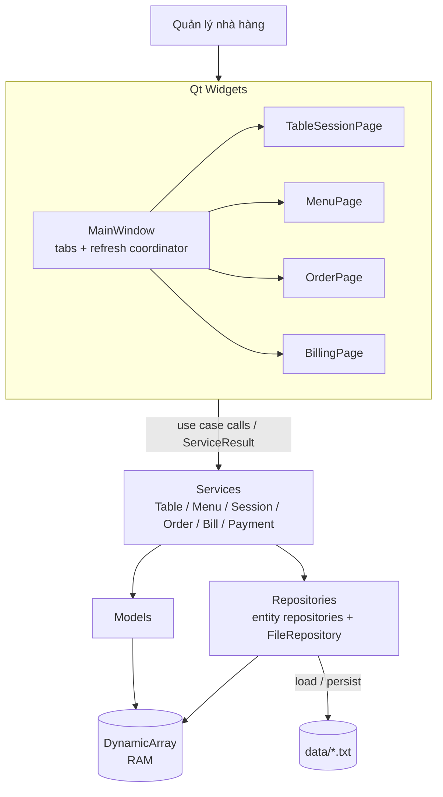
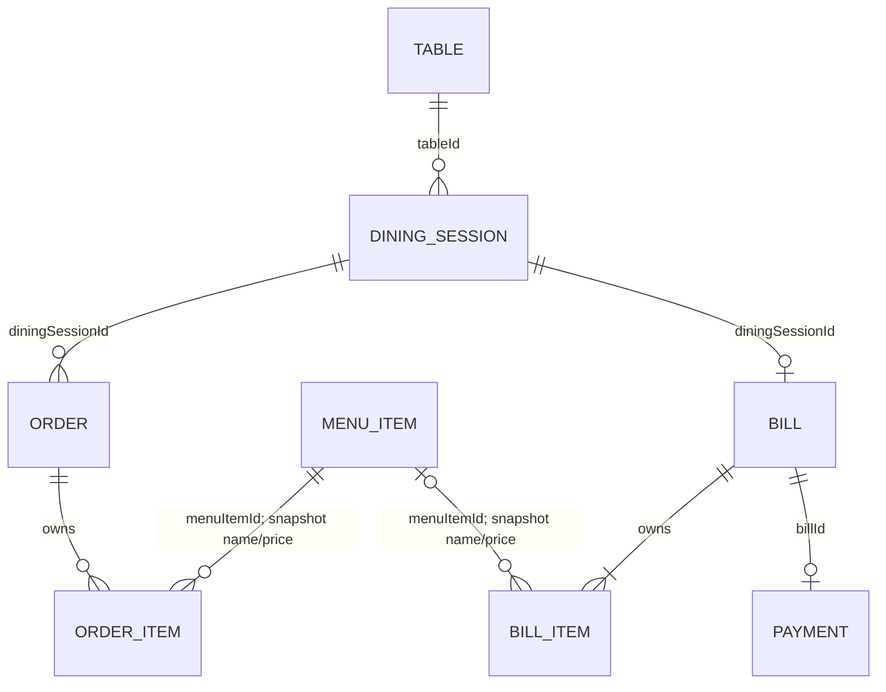
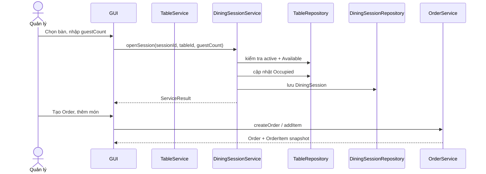
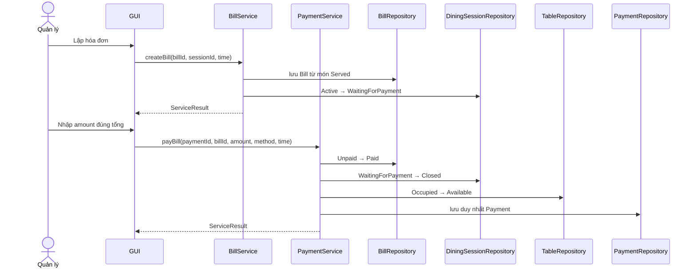
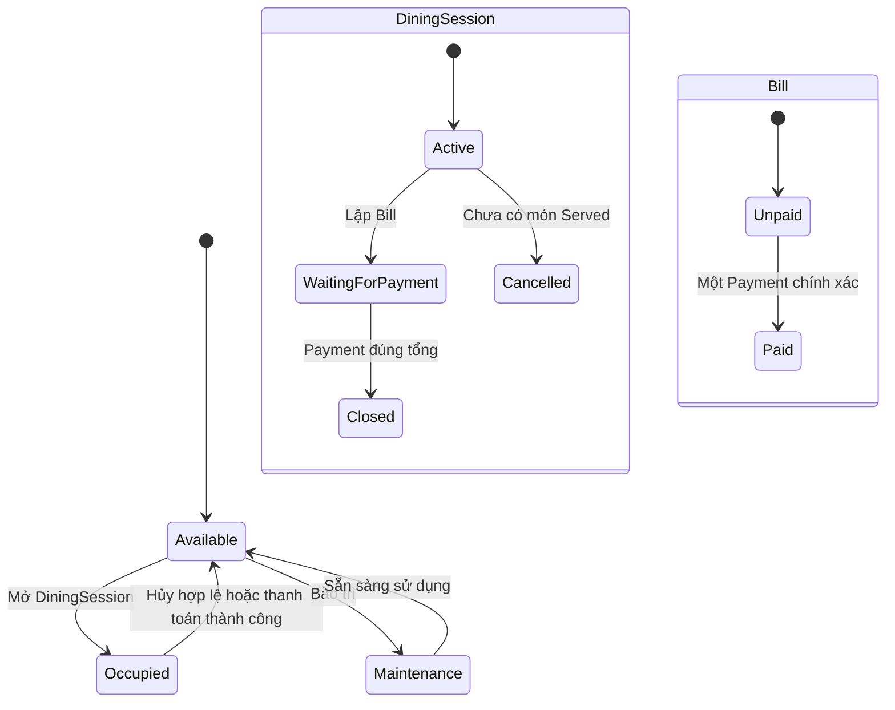

# Sơ đồ hệ thống

Các sơ đồ dưới đây dùng Mermaid và phản ánh cấu trúc đang triển khai. Đây là
model miền nghiệp vụ lưu file, không phải schema SQL/database.

## 1. Kiến trúc

GUI chỉ phụ thuộc Services. Repositories không được gọi trực tiếp từ GUI.

## 2. Quan hệ dữ liệu

ID link không sở hữu entity đích. Order sở hữu OrderItem; Bill sở hữu BillItem.
Snapshot giữ lịch sử giá/tên độc lập với thực đơn hiện tại.

## 3. Luồng mở phiên và gọi món

Việc chọn bàn do Quản lý thực hiện. Service xác thực lại trạng thái bàn khi mở
phiên; `guestCount` không được dùng để chọn bàn hoặc kiểm tra sức chứa.

## 4. Luồng lập hóa đơn và thanh toán

Nếu một bước ghi thất bại, Service cố gắng rollback các bước đã lưu; lỗi rollback
cũng được phản ánh cho GUI.

## 5. Trạng thái tổng quan

Order và OrderItem có trạng thái riêng: Draft/Pending/InProgress/Completed/
Cancelled cho Order; Pending/Served/Cancelled cho OrderItem. Bill chỉ tổng hợp
món Served.
